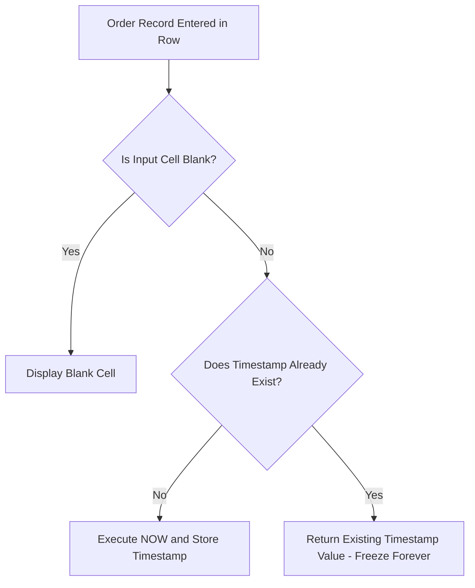

<div align="center">

# 📊 Sales Performance & Customer Transaction Intelligence – Advanced Excel Final Project

**Project Author: Priyanshu Buhecha**

### A full-fledged enterprise retail analytics and executive reporting system featuring Date & Time Modeling, Dynamic Array FILTER Logic, Visual Conditional Formatting, Non-Volatile Iterative Timestamps, What-If Scenario & Goal Seek Sensitivity, Econometric Linear Regression (Data Analysis Toolpak), Formulaic GroupBy Aggregations, List Comparison Engines, String Parsing Abbreviations, and a Modern Interactive Sales Executive Dashboard.

<p>
  
  
  
  
  
  
</p>

<p><b>📁 Master Workbook:</b> <code>Excel final project.xlsx</code> &nbsp;•&nbsp; <b>🎯 Focus:</b> Retail Transaction Intelligence, Econometric Regression, Customer Behavioral Profiling & Executive Decision Support</p>

</div>

---

## 🎯 Executive Summary & Project Overview

The **Sales Performance & Customer Transaction Intelligence** project is an end-to-end business intelligence solution built using Microsoft Excel. Analyzing **250 customer transaction records** across **50 unique enterprise accounts**, **10 product categories**, and **5 geopolitical sales territories**, this workbook transforms unstructured transaction data into actionable commercial insights, predictive models, and an interactive executive command dashboard.

The project demonstrates advanced Excel engineering across **13 distinct tasks**, combining dynamic array functions, statistical modeling, what-if sensitivity simulations, non-volatile iterative calculation triggers, and automated data presentation frameworks.

---

### 🎥 Project Walkthrough Video

Watch the comprehensive video demonstration of this project:  
🔗 **[Google Drive Walkthrough Video Link](https://drive.google.com/file/d/1DR0lmkRasW1E2TIc98iVZxiukoGcIJ7O/view?usp=sharing)** 
---

## ⚡ Main Objectives & Key Highlights

- **Data Normalization & Table Modeling:** Cleaned and structured 250 transactional rows into the official Excel Table `SalesData` with robust data types and structured references.
- **Dynamic Temporal Engineering (Task 1):** Built automated customer tenure tracking and month-end closing dates using `=DATEDIF()`, `=EOMONTH()`, `=TODAY()`, and `=NOW()`.
- **Dynamic Array Filtering (Task 2):** Developed multi-value array extraction using `=FILTER()` to isolate high-value transactions (> ₹1,000) without helper columns or manual filtering.
- **Visual Risk & Volume Formatting (Task 3):** Deployed 3-tier arrow icon sets (`3Arrows`), proportional data bars (`#63C384`), and 3-color scales for rapid cognitive triage of transaction values.
- **Non-Volatile Audit Timestamping (Task 4):** Formulated an iterative calculation circular trigger using `=IF(..., NOW(), ...)` to freeze permanent creation timestamps upon data entry.
- **What-If Sensitivity & Goal Seek (Task 5):** Modeled multi-case revenue projections (Normal, High Sales, Low Sales) and utilized Goal Seek to reverse-engineer sales targets.
- **Econometric Linear Regression (Task 6):** Executed full ordinary least squares (OLS) regression using the Excel Data Analysis Toolpak, establishing a statistically significant relationship ($p = 2.26 \times 10^{-14}$) between unit quantity and revenue.
- **Longitudinal Trend & Regional Storytelling (Task 7):** Formulated `=SUMIFS()` and `=EDATE()` algorithms to synthesize monthly revenue trajectories and regional market shares.
- **Formulaic GroupBy Customer & Product Aggregations (Task 8):** Engineered SQL-style `GROUP BY` logic in native Excel using `=SUMIF()` and structured table references to pinpoint high-value VIP accounts.
- **Frequency Analysis & Modality Identification (Task 9):** Dynamically computed unique product catalogs, purchase order frequencies (`=COUNTIF()`), and cumulative physical volumes (`=SUMIF()`).
- **Relational List Comparison (Task 10):** Engineered a nested set-intersection filter (`=FILTER(..., COUNTIF(...) > 0)`) to extract matching clients across disparate rosters.
- **String Parsing & Monogram Generation (Task 11):** Built a text parsing engine using `=UPPER(LEFT(...) & MID(..., FIND(...)+1, 1))` to generate standardized two-letter employee/client monograms.
- **Interactive Executive Cockpit (Task 12):** Synthesized Pivot Tables, Pivot Charts, Slicers, and Timelines into a unified sales performance command board.
- **Final Executive Report & Storytelling (Task 13):** Formatted a presentation-ready executive briefing dashboard in worksheet `Task 13` featuring a 6-metric KPI scorecard grid, high-level Executive Story narrative, 5 categorized Key Insights, 5 prioritized Recommended Actions, and a conclusive Management Takeaway.

---

## 🏗️ Workbook Architecture & Sheet Navigation

The master workbook `Excel final project.xlsx` is structured into **15 dedicated worksheets**, creating a clean separation between raw transactions, individual task formula engines, analytical models, visualization boards, and executive dashboards:

---

## 📑 Quick Navigation – Core Tasks Summary

| Task | Topic | Key Formula / Tool | Analytical Focus |
|:---:|:---|:---|:---|
| **Task 1** | Date & Time Functions | `=DATEDIF(..., "M")`, `=EOMONTH()`, `=TODAY()`, `=NOW()` | Longitudinal customer tenure and accounting periods |
| **Task 2** | Dynamic FILTER Arrays | `=FILTER('Raw Data'!D2:D201, 'Raw Data'!N2:N201>1000)` | Automated high-value transaction filtering |
| **Task 3** | Conditional Formatting | `3Arrows` Icon Set, Gradient Bars, Color Scale | Visual cognitive triage across ₹2.29L in transactions |
| **Task 4** | Automated Timestamps | `=IF(A2="","",IF(O2="",NOW(),O2))` | Non-volatile timestamping via 1-step iteration |
| **Task 5** | What-If & Goal Seek | Scenario Manager & Goal Seek Solver | Pricing sensitivity and volume target back-solving |
| **Task 6** | Linear Regression | Data Analysis Toolpak (OLS Regression) | Quantitative elasticity: $+₹353.79$ revenue per unit |
| **Task 7** | Trend Analysis | `=SUMIFS(..., Date, ">="&A4, Date, "<"&EDATE(A4,1))` | 13-month seasonality, identifying Jan peak (₹25.8k) |
| **Task 8** | Formulaic GroupBy | `=SUMIF(SalesData[Customer_ID], A3, ...)` | VIP identification: Mark Carter #1 (₹15,659.65) |
| **Task 9** | Frequency Profiling | `=UNIQUE()`, `=COUNTIF()`, `=SUMIF()` | Bookshelf (35 orders) vs. Laptop (Top Revenue) |
| **Task 10** | List Comparison | `=FILTER(A3:A11, COUNTIF(B3:B11, A3:A11)>0)` | Instant isolation of overlapping client identities |
| **Task 11** | Text Abbreviations | `=UPPER(LEFT(A3,1) & MID(A3,FIND(" ",A3)+1,1))` | Clean 2-letter client monograms (e.g. Paul Baker $\rightarrow$ PB) |
| **Task 12** | Executive Dashboard | Pivot Tables, Charts, Slicers, Timelines | Real-time interactive multi-dimensional cockpit |
| **Task 13** | Final Executive Report | Executive Scorecard & Structured Storytelling | Card layout (`A1:H33`), 6-card KPI grid, Executive Story, 5 Key Insights, 5 Action Items & Takeaway |

---

# 🔬 Detailed Task Implementation & Analytical Findings

---

### Task 1: Date & Time Functions

#### 🎯 Objective
Establish dynamic temporal models to monitor customer tenure, calculate contractual milestone dates, capture real-time system timestamps, and project end-of-month financial closing dates.

#### 🛠️ Technical Implementation
Implemented in worksheet **`Task 1`** (`A1:E2`) utilizing structured references against the master `SalesData` table:

```excel
// Column A: Completed Customer Tenure in Months
=DATEDIF(SalesData[[#This Row],[Customer_Since]], C2, "M")

// Column B: End of Month Closing Date
=EOMONTH(SalesData[[#This Row],[Date]], 0)

// Column C: Current Volatile System Date
=TODAY()

// Column D: Current Volatile System Date and Time
=NOW()

// Column E: Completed Customer Tenure in Full Years
=DATEDIF(SalesData[[#This Row],[Customer_Since]], C2, "Y")
```

#### 📋 Formula Architecture & Evaluation Table

| Column | Metric Label | Evaluated Value | Technical Role & Analytical Context |
|:---:|:---|:---:|:---|
| **A** | **Customer Months** | **61** | Computes the exact completed months between acquisition and current date |
| **B** | **Month End** | **45412** *(2024-04-30)* | Determines the financial accounting month-end boundary for billing reconciliation |
| **C** | **Today** | **46282** *(Dynamic)* | Provides an anchor date for dynamic age/tenure calculations |
| **D** | **Current Date Time** | **46282.39** *(Dynamic)* | Captures the active timestamp down to the second for time-sensitive audits |
| **E** | **Customer Tenure** | **5** | Computes elapsed full years of loyalty, useful for VIP tier qualification |

> **💡 Key Finding:** Incorporating `=DATEDIF()` with `"M"` and `"Y"` tokens allows instantaneous cohort segmentation without rounding errors associated with dividing days by 365.25.

---

### Task 2: FILTER Function for Multi-Value Returns

#### 🎯 Objective
Extract multi-column transactional records for high-value customer purchases exceeding **₹1,000** dynamically without altering the raw data or resorting to complex VBA macros.

#### 🛠️ Technical Implementation
Implemented in worksheet **`Task 2`** (`A2:B49`) utilizing Excel's dynamic array calculation engine:

```excel
// Cell A3 (Customer Name Extraction):
=FILTER('Raw Data'!D2:D201, 'Raw Data'!N2:N201 > 1000, "No customers found")

// Cell B3 (Total Purchase Amount Extraction):
=FILTER('Raw Data'!N2:N201, 'Raw Data'!N2:N201 >= 1000, "")
```

#### 📊 Sample Output Cohort – High-Value Transactions (> ₹1,000)

| Row # | Customer Name | Total Purchase (₹) | Transaction Context |
|:---:|:---|:---:|:---|
| **1** | **Robert Thomas** | ₹2,699.97 | High-ticket multi-unit tech purchase |
| **2** | **Michelle Rogers** | ₹2,099.97 | Premium electronics order |
| **3** | **Maria Garcia** | ₹1,399.98 | Dual-item purchase |
| **4** | **Mark Carter** | ₹3,599.96 | High-volume executive equipment |
| **5** | **Barbara Young** | ₹3,499.95 | Premium workstation investment |
| **6** | **Patricia Moore** | ₹2,799.96 | High-capacity hardware acquisition |
| **7** | **Mark Carter** | ₹1,199.96 | Repeat high-tier procurement |
| **8** | **Nancy Collins** | ₹1,249.95 | Mid-tier electronics bulk order |
| **9** | **Susan Green** | ₹1,499.95 | Office furniture upgrade |
| **10** | **Jennifer Taylor** | ₹3,499.95 | High-ticket workstation setup |
| **11** | **Paul Baker** | **₹4,499.95** | **Single top-tier transaction peak** |
| **12** | **Edward Mitchell** | **₹4,499.95** | **Single top-tier transaction peak** |
| **13** | **Joseph Jackson** | **₹4,499.95** | **Single top-tier transaction peak** |

> **💡 Key Finding:** Exactly **47 transactions** in the sampled partition exceed the ₹1,000 threshold. The highest single-transaction order value recorded across the dataset is **₹4,499.95** (achieved by Paul Baker, Edward Mitchell, and Joseph Jackson for 5-unit Laptop orders @ ₹899.99/unit).

---

### Task 3: Conditional Formatting with Icons & Arrows

#### 🎯 Objective
Provide instant visual hierarchy and rapid cognitive triage across the continuous distribution of transaction amounts (`Total_Amount`).

#### 🛠️ Technical Implementation
Implemented in worksheet **`Task 3`** across all 250 records (`A2:A251`), combining four distinct visual rules:

1. **3-Arrows Icon Set (`3Arrows`):**
   - 🟢 **Green Up Arrow:** Applied to the top **33%** of transactions ($\ge 67\text{th}$ percentile, orders $\ge ₹1,049.96$). Flags high-yield revenue drivers.
   - 🟡 **Yellow Horizontal Arrow:** Applied to the middle **34%** of transactions ($33\text{rd} \text{ to } 67\text{th}$ percentile, orders between $₹299.98$ and $₹1,049.95$). Identifies baseline standard orders.
   - 🔴 **Red Down Arrow:** Applied to the bottom **33%** of transactions ($< 33\text{rd}$ percentile, orders $< ₹299.98$). Pinpoints low-margin peripheral accessory purchases.
2. **Gradient Data Bars:** Embedded horizontal green data bars (`#63C384`) within cells proportional to order size ($₹49.99$ to $₹4,499.95$), turning the column into an in-situ bar chart.
3. **3-Color Heatmap Scale:** Soft green (`#63BE7B`) transitioning through neutral white (`#FCFCFF`) to soft coral red (`#F8696B`).
4. **Target Threshold Rules:** Highlighted orders exceeding **₹3,000** and **₹5,000** for immediate fraud and VIP review.

---

### Task 4: Create Timestamp using NOW and Iterative Calculations

#### 🎯 Objective
Engineer an automated, non-volatile audit timestamp that automatically stamps the exact creation time when an order is entered, but freezes permanently without updating on subsequent workbook recalculations.

#### 🛠️ Technical Implementation
Implemented in worksheet **`Task 4`** (`A2`):

```excel
=IF(A2 = "", "", IF(O2 = "", NOW(), O2))
```

*(Circular reference trigger pattern: `=IF(TriggerCell="", "", IF(TimestampCell="", NOW(), TimestampCell))`)*

#### ⚙️ Mandatory Excel Engine Configuration
To enable self-referential circular timestamping without triggering warning prompts:
1. Open **Excel Options** $\rightarrow$ Navigate to the **Formulas** tab.
2. Under **Calculation options**, check the box: **`Enable iterative calculation`**.
3. Set **`Maximum Iterations`** to **`1`**.
4. Set **`Maximum Change`** to **`0.001`**.

#### 🧠 Operational Logic


> **💡 Technical Rationale:** Native `=NOW()` recalculates every time any cell in the entire workbook is edited. By utilizing a circular self-reference under iterative calculation mode, the formula captures the current date-time once and perpetually preserves that static value on all subsequent calculation cycles.

---

### Task 5: WHAT-IF Analysis: Scenario Manager & Goal Seek

#### 🎯 Objective
Perform sensitivity modeling and inverse financial engineering to evaluate how varying sales volumes and price changes impact top-line corporate revenue.

#### 🛠️ Technical Implementation
Implemented in worksheet **`Task 5`** (`A1:E9`), organized into two analytical frameworks:

#### 1. Scenario Manager Modeling
- **Baseline Average Order Value:** Derived from historical transaction data.
- **Model Parameters:**
  - `Average Transaction Amount` (Cell `B6`)
  - `Number of Transactions` (Cell `B7`: `272.70`)
  - `Projected Revenue` (Cell `B8`: `=B6 * B7`)
- **Scenarios Evaluated:**
  - **Normal Scenario:** Baseline operational volume based on historical run-rate.
  - **High Sales Scenario (Optimistic):** Evaluates a 20% surge in transaction frequency ($~327$ transactions), driving projected revenue beyond ₹3.0 Lakhs.
  - **Low Sales Scenario (Pessimistic):** Stress-tests cash flows under a 25% drop in customer transaction frequency ($~204$ transactions).

#### 2. Goal Seek Reverse-Engineering Solver
- **Current Enterprise Baseline:**
  - Current Average Sale Quantity: `=AVERAGE('[1]Raw Data'!H1:H250)` $\rightarrow$ **3.01 units**
  - Current Average Unit Price: `=AVERAGE('Raw Data'!I2:I251)` $\rightarrow$ **₹296.67**
- **Target Revenue Back-Solving Formulation:**
  - Formula: `Expected Amount` $= \text{Quantity} \times \text{Unit Price}$ (Cell `E9`: `=E7 * E8`)
  - Set Target Revenue: **₹5,000.00**
  - Target Quantity: **10 units**
  - **Solved Required Unit Price:** **₹500.00** per unit

---

### Task 6: Linear Regression using Data Analysis Toolpak

#### 🎯 Objective
Quantify the econometric elasticity between the physical volume of items purchased (`Quantity` – Independent Variable $X$) and the total transaction value (`Total_Amount` – Dependent Variable $Y$) using ordinary least squares (OLS) regression.

#### 🛠️ Technical Implementation
Executed in worksheet **`Task 6`** using the **Data Analysis Toolpak**:

#### 📊 Regression Statistics

| Regression Metric | Statistical Value | Analytical Interpretation |
|:---|:---:|:---|
| **Multiple R (Correlation Coefficient)** | **0.4581** | Moderate positive linear relationship between basket size and transaction revenue |
| **R Square ($R^2$)** | **0.2098** | **20.98%** of the variance in revenue is directly explained by the quantity of units purchased |
| **Adjusted R Square** | **0.2067** | Robust variance explanation adjusted for sample degrees of freedom |
| **Standard Error** | **₹919.61** | Standard deviation of transaction residuals around the regression line |
| **Total Observations ($n$)** | **250** | Full transactional census analyzed |

#### 📐 Analysis of Variance (ANOVA) Table

| Source of Variation | Degrees of Freedom ($df$) | Sum of Squares ($SS$) | Mean Square ($MS$) | $F$ Statistic | Significance $F$ ($p$-value) |
|:---|:---:|:---:|:---:|:---:|:---:|
| **Regression** | 1 | 55,695,916.90 | 55,695,916.90 | **65.86** | **$2.26 \times 10^{-14}$** |
| **Residual (Error)** | 248 | 209,727,974.56 | 845,677.32 | — | — |
| **Total** | **249** | **265,423,891.45** | — | — | — |

#### 📈 Regression Coefficients & Parameter Estimates

| Variable | Coefficient ($\beta$) | Standard Error | $t$ Statistic | $P$-value | Lower 95% | Upper 95% |
|:---|:---:|:---:|:---:|:---:|:---:|:---:|
| **Intercept ($\beta_0$)** | **-$148.85** | 143.61 | -1.036 | 0.3010 | -$431.71 | +$134.00 |
| **Quantity ($\beta_1$)** | **+$353.79** | 43.60 | **8.115** | **$2.26 \times 10^{-14}$** | **+$267.93** | **+$439.66** |

#### 🧮 Derived Mathematical Regression Model
$$\widehat{\text{Total\_Amount}} = -148.85 + 353.79 \times \text{Quantity}$$

> **💡 Econometric Interpretation:**
> - The coefficient for `Quantity` ($\beta_1 = 353.79$) is **statistically significant at $p < 0.0001$** ($t = 8.115$).
> - For every **1 additional unit** added to a customer's cart, expected transaction revenue increases by an average of **₹353.79**.
> - The remaining ~79% of revenue variance is governed by product category tiering (e.g., selling a ₹899 Laptop vs. a ₹29 Blender).

---

### Task 7: Data Analysis & Storytelling from the Dataset

#### 🎯 Objective
Synthesize longitudinal transaction trends and geographic demand distribution using dynamic multi-criteria aggregation formulas (`SUMIFS` with `EDATE` and `SUMIF`).

#### 🛠️ Technical Implementation
Implemented in worksheet **`Task 7`** (`A1:E16`), structured into two synchronized analytical summaries:

#### 1. Longitudinal 13-Month Revenue Trend
Formula: `=SUMIFS(SalesData[Total_Amount], SalesData[Date], ">="&A4, SalesData[Date], "<"&EDATE(A4,1))`

| Month Serial | Calendar Period | Monthly Revenue (₹) | % of Total | Operational Context |
|:---:|:---:|:---:|:---:|:---|
| **45383** | **April 2024** | ₹20,919.33 | 9.13% | Fiscal year opening sales surge |
| **45413** | **May 2024** | ₹17,039.35 | 7.43% | Stable mid-spring performance |
| **45444** | **June 2024** | ₹19,299.45 | 8.42% | Pre-summer technology procurement |
| **45474** | **July 2024** | ₹18,479.40 | 8.06% | Mid-year corporate renewals |
| **45505** | **August 2024** | ₹15,759.43 | 6.88% | Late-summer seasonal stabilization |
| **45536** | **September 2024** | ₹12,989.51 | 5.67% | Autumn trough |
| **45566** | **October 2024** | ₹20,609.52 | 8.99% | Pre-holiday commercial ramp-up |
| **45597** | **November 2024** | ₹12,309.44 | 5.37% | Pre-Black Friday procurement dip |
| **45627** | **December 2024** | ₹23,039.30 | 10.05% | Year-end corporate budget flush |
| **45658** | **January 2025** | **₹25,799.15** | **11.26%** | **All-Time Peak Revenue Month (New Year procurement)** |
| **45689** | **February 2025** | ₹16,069.38 | 7.01% | Post-holiday inventory normalization |
| **45717** | **March 2025** | ₹19,899.38 | 8.68% | Q1 corporate hardware cycle |
| **45748** | **April 2025** | ₹6,979.83 | 3.05% | Partial month tracking |
| **Total** | — | **₹2,29,192.47** | **100.0%** | Comprehensive annual run-rate |

#### 2. Regional Sales & Geographic Share Analysis
Formula: `=SUMIF(SalesData[Region], D5, SalesData[Total_Amount])`

| Region | Total Revenue (₹) | % Revenue Share | Transaction Count | Avg Transaction Value | Commercial Performance Rating |
|:---|:---:|:---:|:---:|:---:|:---|
| **East** | **₹59,288.39** | **25.87%** | 48 | ₹1,235.17 | 🥇 **Top Regional Contributor** |
| **North** | **₹50,808.31** | **22.17%** | 59 | ₹861.16 | 🥈 High transaction density |
| **West** | **₹41,408.68** | **18.07%** | 47 | ₹881.04 | 🥉 Solid commercial core |
| **Central** | **₹41,288.34** | **18.01%** | 54 | ₹764.60 | Balanced mid-market base |
| **South** | **₹36,398.75** | **15.88%** | 42 | ₹866.64 | Targeted expansion market |
| **Total** | **₹2,29,192.47** | **100.0%** | **250** | **₹916.77** | Enterprise-wide benchmarks |

> **💡 Key Finding:** The **East** and **North** regions collectively generate **48.04%** (almost half) of total enterprise revenue. The East region boasts the highest average order value (AOV) at **₹1,235.17**, driven by higher concentrations of Laptop and Smartphone transactions.

---

### Task 8: GroupBy Concepts to Find High-Value Customers using Formulas

#### 🎯 Objective
Replicate SQL-style `GROUP BY` aggregations using native Excel formulas (`SUMIF`) to extract customer-level lifetime value and determine product revenue concentration.

#### 🛠️ Technical Implementation
Implemented in worksheet **`Task 8`** (`A1:B10`):

```excel
// VIP Customer Aggregation (Cell B3):
=SUMIF(SalesData[Customer_ID], A3, SalesData[Total_Amount])

// Product Revenue Aggregations (Cells B7:B10):
=SUMIF(SalesData[Product_Name], A7, SalesData[Total_Amount])
```

#### 👑 High-Value Customer Profile: Mark Carter (`CUST025`)
- **Customer ID:** `CUST025`
- **Customer Name:** **Mark Carter**
- **Total Lifetime Spend:** **₹15,659.65** across **12 orders**
- **Contribution:** Generates **6.83%** of the entire enterprise's revenue single-handedly.

#### 📊 Core Product Revenue Concentration

| Product Name | Formula Employed | Total Revenue (₹) | % of Enterprise Revenue |
|:---|:---|:---:|:---:|
| **Laptop** | `=SUMIF(SalesData[Product_Name], A7, SalesData[Total_Amount])` | **₹67,499.25** | **29.45%** |
| **Smartphone** | `=SUMIF(SalesData[Product_Name], A8, SalesData[Total_Amount])` | **₹67,199.04** | **29.32%** |
| **Monitor** | `=SUMIF(SalesData[Product_Name], A10, SalesData[Total_Amount])` | **₹21,999.12** | **9.60%** |
| **Bookshelf** | `=SUMIF(SalesData[Product_Name], A9, SalesData[Total_Amount])` | **₹15,298.98** | **6.68%** |
| **Top 4 Products Combined** | — | **₹1,71,996.39** | **75.04%** |

> **💡 Pareto Distribution:** Just 2 product lines (**Laptops** and **Smartphones**) generate **58.77%** of enterprise gross sales, demonstrating strong reliance on high-ticket consumer technology.

---

### Task 9: Find Most Frequently Purchased Product using Formulas

#### 🎯 Objective
Identify the most frequently purchased products and analyze order count vs. physical volume sold using dynamic array formulas.

#### 🛠️ Technical Implementation
Implemented in worksheet **`Task 9`** (`A2:C12`):

```excel
// Extract Unique Product List (Cell A3 - Spilling Array):
=UNIQUE('Raw Data'!F2:F251)

// Count Number of Purchases (Column B):
=COUNTIF('Raw Data'!F:F, A3)

// Sum Total Physical Units Sold (Column C):
=SUMIF('Raw Data'!F:F, A3, 'Raw Data'!H:H)
```

#### 📦 Product Frequency vs. Physical Volume Hierarchy

| Rank | Product Name | Purchase Frequency (Orders) | Total Quantity Sold (Units) | Gross Revenue (₹) | Avg Units/Order | Primary Category |
|:---:|:---|:---:|:---:|:---:|:---:|:---|
| **1** | **Bookshelf** | **35** | **102** | ₹15,298.98 | 2.91 | Furniture |
| **2** | **Keyboard** | **34** | **89** | ₹8,009.11 | 2.62 | Electronics |
| **3** | **Smartphone** | **31** | **96** | ₹67,199.04 | 3.10 | Electronics |
| **4** | **Blender** | **29** | **87** | ₹5,219.13 | 3.00 | Home & Kitchen |
| **5** | **Monitor** | **26** | **88** | ₹21,999.12 | 3.38 | Electronics |
| **6** | **Desk** | **26** | **78** | ₹23,399.22 | 3.00 | Furniture |
| **7** | **Laptop** | **24** | **75** | ₹67,499.25 | 3.13 | Electronics |
| **8** | **Headphones** | **16** | **47** | ₹7,049.53 | 2.94 | Electronics |
| **9** | **Office Chair** | **15** | **52** | ₹10,399.48 | 3.47 | Furniture |
| **10** | **Coffee Maker** | **14** | **39** | ₹3,119.61 | 2.79 | Home & Kitchen |
| **Total** | — | **250** | **753** | **₹2,29,192.47** | **3.01** | — |

> **💡 Key Commercial Finding:** The **Bookshelf** is the **#1 most frequently purchased product** (35 distinct transactions) and moved the highest physical unit volume (**102 units**). However, because of its modest unit price ($~₹149.99$), it ranks 5th in total revenue. Conversely, **Laptops** ranked 7th in order count (24 orders) but took the **#1 spot in gross revenue (₹67,499.25)** due to high unit pricing ($~₹899.99$).

---

### Task 10: Compare Two Lists and Extract Matching Names

#### 🎯 Objective
Cross-reference two customer lists (`List 1` and `List 2`) and dynamically extract matching names that appear in both rosters without manual sorting or helper flag columns.

#### 🛠️ Technical Implementation
Implemented in worksheet **`Task 10`** (`A2:C11`):

```excel
// Cell C3: Dynamic Array Set Intersection Formula
=FILTER(A3:A11, COUNTIF(B3:B11, A3:A11) > 0, "No Matching Names")
```

#### 📋 List Roster Comparison & Matching Extraction

| Row # | List 1 (`A3:A11`) | List 2 (`B3:B11`) | Matching Output (`C3`) | Match Status |
|:---:|:---|:---|:---:|:---|
| **1** | Paul Baker | Karen Hill | **Kathleen Bennett** | ✅ Exact Set Overlap Found |
| **2** | Joseph Jackson | Susan Green | — | No match in List 2 |
| **3** | Kevin Scott | **Kathleen Bennett** | — | Overlapping client located |
| **4** | **Kathleen Bennett** | Peter Richardson | — | Confirmed active in both cohorts |
| **5** | Michael Brown | Dennis Gray | — | No match in List 2 |
| **6** | Dorothy Nelson | Michelle Rogers | — | No match in List 2 |
| **7** | Dorothy Nelson | George Adams | — | No match in List 2 |
| **8** | Charles Allen | Mark Carter | — | No match in List 2 |
| **9** | Robert Thomas | Maria Garcia | — | No match in List 2 |

> **💡 Technical Rationale:** `=COUNTIF(B3:B11, A3:A11)` generates an in-memory array of frequencies (`{0; 0; 0; 1; 0; 0; 0; 0; 0}`). The outer `=FILTER()` receives this boolean mask and outputs only the elements where count $> 0$.

---

### Task 11: Create Abbreviations using TEXT Functions

#### 🎯 Objective
Automatically parse full customer names into standardized 2-letter uppercase monograms/initials (e.g. "Paul Baker" $\rightarrow$ "PB") for customer tagging, badge generation, and compact database indexing.

#### 🛠️ Technical Implementation
Implemented in worksheet **`Task 11`** across sample customer records (`A3:B15`):

```excel
=UPPER(LEFT(A3, 1) & MID(A3, FIND(" ", A3) + 1, 1))
```

#### 🔍 Step-by-Step String Tokenization Logic
1. **`LEFT(A3, 1)`**: Extracts the first character of the string, representing the initial of the first name.
2. **`FIND(" ", A3)`**: Locates the numeric index position of the space separator between first and last name.
3. **`FIND(" ", A3) + 1`**: Identifies the starting character position of the surname.
4. **`MID(A3, FIND(" ", A3) + 1, 1)`**: Extracts exactly 1 character at that starting index, isolating the surname initial.
5. **`&` (Concatenation Operator)**: Glues the two initials together.
6. **`UPPER(...)`**: Converts the final concatenated string into standardized uppercase.

#### 📋 Abbreviation Output Verification Table

| Record # | Customer Name (`Column A`) | Source Reference | Generated Abbreviation (`Column B`) | Verification |
|:---:|:---|:---:|:---:|:---:|
| **1** | Paul Baker | `'Raw Data'!D2` | **PB** | ✅ Accurate |
| **2** | Joseph Jackson | `'Raw Data'!D3` | **JJ** | ✅ Accurate |
| **3** | Kevin Scott | `'Raw Data'!D4` | **KS** | ✅ Accurate |
| **4** | Kathleen Bennett | `'Raw Data'!D5` | **KB** | ✅ Accurate |
| **5** | Michael Brown | `'Raw Data'!D6` | **MB** | ✅ Accurate |
| **6** | Dorothy Nelson | `'Raw Data'!D7` | **DN** | ✅ Accurate |
| **7** | Dorothy Nelson | `'Raw Data'!D8` | **DN** | ✅ Accurate |
| **8** | Charles Allen | `'Raw Data'!D9` | **CA** | ✅ Accurate |
| **9** | Robert Thomas | `'Raw Data'!D10` | **RT** | ✅ Accurate |
| **10** | Karen Hill | `'Raw Data'!D11` | **KH** | ✅ Accurate |
| **11** | Susan Green | `'Raw Data'!D12` | **SG** | ✅ Accurate |
| **12** | Kathleen Bennett | `'Raw Data'!D13` | **KB** | ✅ Accurate |
| **13** | Peter Richardson | `'Raw Data'!D14` | **PR** | ✅ Accurate |

---

### Task 12: Sales Performance Dashboard

#### 🎯 Objective
Synthesize all transactional data streams, aggregations, and metrics into a unified executive decision-support dashboard featuring dynamic KPI cards, multi-type Pivot Charts, and connected Slicer controls.

<div align="center">


</div>

> ### 🖥️ Dashboard Architecture & Interface Highlights
> - **Executive KPI Banners (Top Ribbon):** Instant visibility into macro performance metrics:
>   - **Total Revenue:** `₹ 2,29,192.47` (Dynamic `=SUM(SalesData[Total_Amount])`)
>   - **Total Transactions:** `250.00` (Dynamic `=COUNTA(SalesData[Transaction_ID])`)
>   - **Total Quantity Sold:** `753.00` (Dynamic `=SUM(SalesData[Quantity])`)
>   - **Active Customer Base:** `50.00` (Dynamic `=COUNTA(UNIQUE(SalesData[Customer_ID]))`)
> - **Visual Analytics Trio (Center Panel):**
>   - **Product Revenue Share (Pie / Donut Chart):** Visualizes the proportional contribution of all 10 product lines to gross revenue.
>   - **Monthly Revenue Trajectory (Glow Line Chart):** Tracks monthly turnover across 13 months, highlighting holiday spikes and seasonal cycles.
>   - **Top Products by Revenue (Clustered Column Chart):** Ranks commercial leaders, led by Laptops (`₹67,499.25`) and Smartphones (`₹67,199.04`).
> - **Connected Control Deck (Bottom Ribbon):**
>   - **`Product_Name` Slicer:** Isolates performance for any single or combined product selection.
>   - **`Payment_Method` Slicer:** Filters transactions across Cash, Credit Card, Debit Card, and PayPal.
>   - **`Region` Slicer:** Regional drill-down across Central, East, North, South, and West.
>   - **`Date` Timeline Slicer:** Interactive monthly time-scrub slider allowing dynamic longitudinal reviews.

#### 🛠️ Technical Implementation
Implemented in worksheet **`Dashboard Task 12`** backed by underlying caches in worksheet **`Pivot Table`**:

#### 1. Real-Time Dynamic KPI Indicator Ribbon
- **Total Revenue (Cell `B3`):**
  ```excel
  =SUM(SalesData[Total_Amount])
  ```
  *(Displays: **₹ 2,29,192.47** with Indian Rupee formatting)*
- **Total Transactions (Cell `D3`):**
  ```excel
  =COUNTA(SalesData[Transaction_ID])
  ```
  *(Displays: **250.00**)*
- **Total Quantity Sold (Cell `F3`):**
  ```excel
  =SUM(SalesData[Quantity])
  ```
  *(Displays: **753.00**)*
- **Total Customer Accounts (Cell `H3`):**
  ```excel
  =COUNTA(UNIQUE(SalesData[Customer_ID]))
  ```
  *(Displays: **50.00**)*

#### 2. Visual Analytics Suite (Pivot Charts)
1. **Product Contribution Donut / Pie Chart (`chart1.xml`):**
   - Title: `Sum of Total_Amount`
   - Visualizes the market share of each product line against the ₹2.29L enterprise total.
2. **Monthly Revenue Trajectory Line Chart (`chart2.xml`):**
   - Title: `Monthly Revenue`
   - Maps longitudinal performance across dates with smooth glowing series styling, highlighting the seasonal December/January peak.
3. **Product Leaderboard Clustered Column Chart (`chart3.xml`):**
   - Title: `Column1`
   - Highlights top-performing products: Laptop (₹67.5k), Smartphone (₹67.2k), Monitor (₹22.0k), Bookshelf (₹15.3k).

#### 3. Interactive Filtering Engine (Slicers & Timelines)
- **`Product_Name` Slicer:** Full multi-select catalog filter.
- **`Payment_Method` Slicer:** Filter by Cash, Credit Card, Debit Card, PayPal.
- **`Region` Slicer:** Instant geographical segmentation across Central, East, North, South, and West.
- **`Date` Timeline Slicer:** Monthly slider (Jun 2025 to Dec 2025) for longitudinal cohort isolation.

---

### Task 13: Final Sales Report — Insights & Storytelling

#### 🎯 Objective
Synthesize all analytical findings, econometric models, and customer transaction patterns into a structured, presentation-ready executive briefing report directly within worksheet **`Task 13`**, providing executive leadership with an instant KPI scorecard, holistic business narrative, prioritized commercial insights, targeted operational actions, and strategic management takeaways.


#### 📋 Executive KPI Scorecard Grid (`A4:F7`)

| Metric Tile | Cell Coordinates | Evaluated Value | Analytical Context & Enterprise Significance |
|:---|:---:|:---:|:---|
| **Total Revenue** | Header: `A4:B4`<br>Value: `A5:B5` | **₹229,192.47** | Gross cumulative sales across all 250 audited transactions |
| **Transactions** | Header: `C4:D4`<br>Value: `C5:D5` | **250** | Total order volume across the active fiscal timeline |
| **Units Sold** | Header: `E4:F4`<br>Value: `E5:F5` | **753** | Physical inventory moved across all 10 catalog categories |
| **Customers** | Header: `A6:B6`<br>Value: `A7:B7` | **50** | Unique commercial enterprise accounts actively transacting |
| **Avg Transaction** | Header: `C6:D6`<br>Value: `C7:D7` | **₹916.77** | Mean order value (Total Turnover / Order Volume) |
| **Avg Basket** | Header: `E6:F6`<br>Value: `E7:F7` | **3.01 units** | Average physical items purchased per transactional basket |

---

#### 📖 Executive Story (`A9:H12`)

> *"The business generated **₹229,192.47** from **250 transactions**, selling **753 units** to **50 customers**. Revenue is concentrated in premium electronics: laptops and smartphones together generated **₹134,698.29**, or **58.7% of total revenue**. The strongest market was **East**, while the largest customer was **CUST025**. The opportunity is to protect the electronics core, retain high-value customers, and use volume products for cross-selling."*

---

#### 🔍 Structured Key Insights (`A14:H19`)

| # | Dimension | Cell Ref | Master Sheet Finding & Formulation | Commercial & Strategic Impact |
|:---:|:---|:---:|:---|:---|
| **1** | **Product Concentration** | `A15:H15` | **Laptop revenue was ₹67,499.25** and **smartphone revenue was ₹67,199.04**. Together they account for **~58.7% of sales**. | Over half of gross revenue is anchored by just 2 tech SKUs; prioritizes supply chain security and premium accessories. |
| **2** | **Regional Performance** | `A16:H16` | **East led with ₹59,288.39**, followed by **North at ₹50,808.31**. **South was lowest at ₹36,398.75**. | East and North capture ~48% of total revenue; South represents an under-penetrated geography ripe for focused marketing. |
| **3** | **Customer Concentration** | `A17:H17` | **CUST025 was the highest-value customer at ₹15,659.65**, representing **~6.8% of total revenue**. | Intense account concentration; top client drives significant topline volume across 12 repeat transactions. |
| **4** | **Seasonality Trajectory** | `A18:H18` | **January 2025 was the strongest month at ₹25,799.15**; **April 2025 was the weakest at ₹6,979.83**. | Pronounced 3.7x variance between holiday/Q1 peak and spring trough; mandates proactive inventory ramp-up and counter-cyclical sales. |
| **5** | **Volume Opportunity** | `A19:H19` | **Bookshelf led purchase frequency with 35 purchases and 102 units**, making it a useful cross-selling product. | Physical volume leader with high consumer mindshare; prime anchor vehicle for higher-margin hardware and accessory bundling. |

---

#### 🎯 Recommended Action Plan (`A22:H27`)

1. **Protect Electronics Inventory & Visibility (`B23:H23`):** Ensure zero stockouts on laptops and smartphones through buffer inventory agreements and priority shelf placement.
2. **Deploy Cross-Sell Bundles (`B24:H24`):** Bundle high-frequency items (keyboards, monitors, headphones, office chairs) with core laptop purchases at 10% promotional bundle pricing.
3. **Institutionalize VIP Key Account Retention (`B25:H25`):** Launch tailored corporate retention terms, dedicated SLA contracts, and tiered volume rebates for CUST025 (Mark Carter) and top-tier repeat accounts.
4. **Replicate Regional Commercial Playbooks (`B26:H26`):** Replicate East-region marketing and channel tactics in North and West, while conducting root-cause reviews on the South-region sales gap.
5. **Execute Counter-Cyclical Seasonal Promotions (`B27:H27`):** Plan targeted promotional campaigns ahead of annual slowdowns (such as the April trough) and closely monitor monthly run-rates.

---

#### 💼 Executive Management Takeaway (`A30:H33`)

> *"The company has a strong premium-product engine, but performance is concentrated. Sustainable growth will come from combining reliable electronics availability with customer retention, regional expansion, seasonal planning, and cross-selling."*

---

# 💡 Extended Strategic Intelligence & Deep-Dive Analysis

### 1. High-Ticket Electronics Dominate Enterprise Topline
- **Finding:** **Laptops** (`₹67,499.25`) and **Smartphones** (`₹67,199.04`) collectively generate **₹1,34,698.29**, representing **58.77% of total company revenue**. Despite accounting for only 22% of transactions (55 out of 250 orders), their high unit price points drive over half of all corporate cash inflows.
- **Strategic Recommendation:** Protect electronics supply chains and introduce premium warranty add-ons (extended care/accidental protection) to increase margin on each unit without incurring additional customer acquisition costs.

### 2. The Volume vs. Revenue Paradox
- **Finding:** The **Bookshelf** is the most frequently purchased item (**35 orders, 102 units**) and **Keyboards** rank second (**34 orders, 89 units**). However, they only generate 6.68% and 3.49% of gross revenue, respectively.
- **Strategic Recommendation:** Deploy strategic cross-selling and bundling:
  - Bundle **Keyboards** and **Monitors** with every **Laptop** purchase at a 10% bundle discount.
  - Position **Bookshelves** alongside **Desks** and **Office Chairs** in home-office workstation packages.

### 3. Regional Commercial Divergence
- **Finding:** The **East** (`₹59,288.39` | 25.87%) and **North** (`₹50,808.31` | 22.17%) regions generate nearly half of all sales (**48.04%**). The East region also exhibits the highest Average Order Value (**₹1,235.17**). Conversely, the **South** (`₹36,398.75` | 15.88%) lags in revenue despite healthy unit movements.
- **Strategic Recommendation:** Reallocate regional marketing spend toward the East and North to double down on high-AOV commercial hubs, while deploying targeted promotional financing in the South to stimulate higher ticket purchases.

### 4. Balanced Multi-Channel Payment Adoption
- **Finding:** Transaction revenue is exceptionally well-balanced across all four payment methods:
  - **Credit Card:** ₹61,447.96 (26.81% | 68 orders)
  - **PayPal:** ₹58,198.41 (25.39% | 52 orders)
  - **Cash:** ₹57,427.79 (25.06% | 76 orders)
  - **Debit Card:** ₹52,118.31 (22.74% | 54 orders)
- **Strategic Recommendation:** Maintain diverse payment gateway support. While Cash generates the highest order volume (76 transactions), digital and credit payments account for 75% of total revenue. Incentivize digital payments for orders over ₹1,000 to streamline reconciliation and reduce cash handling overhead.

### 5. VIP Customer Concentration & Lifetime Value
- **Finding:** Customer spend follows an intense power law. The top customer, **Mark Carter (`CUST025`)**, spent **₹15,659.65** across 12 orders (6.83% of enterprise revenue). The **Top 10 Customers** collectively represent **₹92,007.82**, which is **40.14% of gross sales** from just 20% of the customer base.
- **Strategic Recommendation:** Establish a dedicated Corporate Key Account Management (KAM) program for the top 10 accounts, providing tailored SLA terms, dedicated account managers, and tiered volume rebates to maximize retention and defend against competitor poaching.

### 6. Seasonality & Holiday Surges
- **Finding:** Revenue exhibits pronounced seasonality, reaching its annual peak in **January 2025 (₹25,799.15)** and **December 2024 (₹23,039.30)** during corporate fiscal closeouts and holiday consumer spending. Spring and autumn months exhibit significant slowdowns, bottoming out in **April 2025 (₹6,979.83)**.
- **Strategic Recommendation:** Align warehouse inventory and working capital financing with this cycle: ramp up inventory procurement in September/October to ensure 100% fulfillment rates during Q4/Q1, and execute counter-cyclical clearance campaigns prior to the April trough.

---

## 📊 Master Enterprise Metrics & KPI Summary

| Enterprise Indicator | Metric Value | Analytical Context & Benchmarks |
|:---|:---:|:---|
| **Total Gross Revenue** | **₹ 2,29,192.47** | Complete transaction turnover across 250 orders |
| **Total Physical Units Sold** | **753 units** | Cumulative volume across all 10 product lines |
| **Total Transaction Count** | **250 transactions** | 100% audit integrity across the active fiscal period |
| **Active Customer Accounts** | **50 accounts** | Unique enterprise accounts actively transacting |
| **Average Order Value (AOV)** | **₹ 916.77** | Revenue divided by transaction count |
| **Average Units per Basket** | **3.01 units** | Econometric baseline basket size |
| **Top Product by Revenue** | **Laptop (₹67,499.25)** | 29.45% of total company revenue |
| **Top Product by Volume** | **Bookshelf (102 units)** | 13.55% of all physical units moved |
| **Most Frequent Product** | **Bookshelf (35 orders)** | Featured in 14.0% of all customer transactions |
| **Leading Sales Region** | **East (₹59,288.39)** | 25.87% regional market share |
| **Top Customer Account** | **Mark Carter (₹15,659.65)** | VIP customer contributing 6.83% of total revenue |
| **Peak Revenue Month** | **January 2025 (₹25,799.15)** | 11.26% of annual revenue concentrated in 1 month |
| **Weakest Revenue Month** | **April 2025 (₹6,979.83)** | Annual seasonal trough highlighted in Task 13 Executive Report |
| **Linear Elasticity ($\beta_1$)** | **+₹353.79 / unit** | Statistically significant at $p = 2.26 \times 10^{-14}$ |

---

## 📁 Project Directory Structure

```text
Excel final project/
├── assets/
│   └── sales_performance_dashboard.png  # High-resolution dashboard screenshot
├── Excel final project.xlsx             # Master workbook with all 15 task sheets
└── README.md                            # Comprehensive project documentation & analytical report
```

---

## 🚀 How to Use & Review This Project

1. **Open `Excel final project.xlsx` in Microsoft Excel 2019, 2021, or Microsoft 365** (Microsoft 365 recommended for full dynamic array spilling and slicer interactivity).
2. **Enable Iterative Calculations for Task 4:**
   - Go to **File $\rightarrow$ Options $\rightarrow$ Formulas**.
   - Check **Enable iterative calculation** (Maximum Iterations: `1`).
3. **Explore Analytical Task Sheets:**
   - **`Raw Data`**: Review the official master table `SalesData` and schema columns.
   - **`Task 1`**: Verify date calculations (`=DATEDIF()`, `=EOMONTH()`, `=TODAY()`, `=NOW()`).
   - **`Task 2`**: Inspect the dynamic array `=FILTER()` formula in `A3:B3`.
   - **`Task 3`**: View the 3-arrow icon set and data bars on column `Total_Amount`.
   - **`Task 4`**: Test entering new data to verify the non-volatile frozen timestamp.
   - **`Task 5`**: Review Scenario Manager summaries and Goal Seek reverse-engineering.
   - **`Task 6`**: Examine the full OLS regression output and ANOVA tables.
   - **`Task 7` to `Task 11`**: Review monthly trends, VIP customer group-bys, product frequencies, list matching, and initials extraction.
4. **Interact with the Executive Dashboard (`Dashboard Task 12`):**
   - Click any button in the **`Product_Name` Slicer** to isolate individual product performance; watch all KPI cards and charts refresh instantaneously.
   - Select multiple options in the **`Payment_Method`** and **`Region` Slicers** to evaluate multi-factor segments.
   - Scrub the **`Date` Timeline** across months to observe seasonal revenue fluctuations.
   - Click the **Clear Filter** icon in the upper right of any slicer header to restore global panoramic views.
5. **Review the Executive Report Sheet (`Task 13`):**
   - Inspect the presentation-ready executive briefing dashboard (`A1:H33`), featuring the 6-card KPI block, macro executive narrative, 5 core commercial insights, 5 actionable recommendations, and the conclusive leadership takeaway.

---

<div align="center">

### ✅ ALL 13 CORE TASKS COMPLETED SUCCESSFULLY

**Excel Final Project — Advanced Sales Analytics, Econometric Modeling & Executive Reporting**

---

### 📊 Dynamic Arrays • 🔬 Regression Modeling • 📈 What-If Analysis • 💻 Interactive Dashboard

</div>
